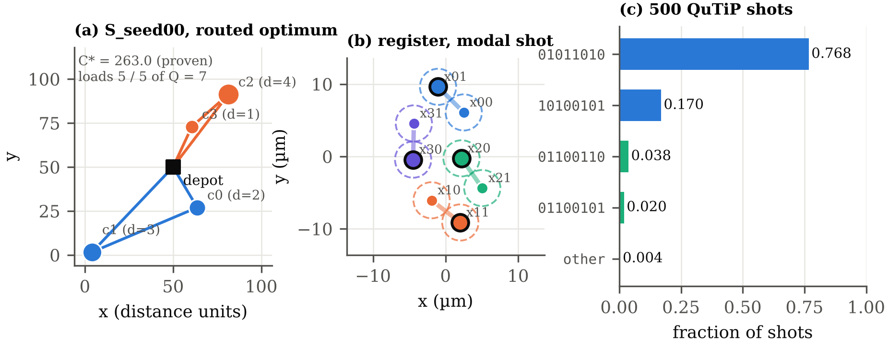
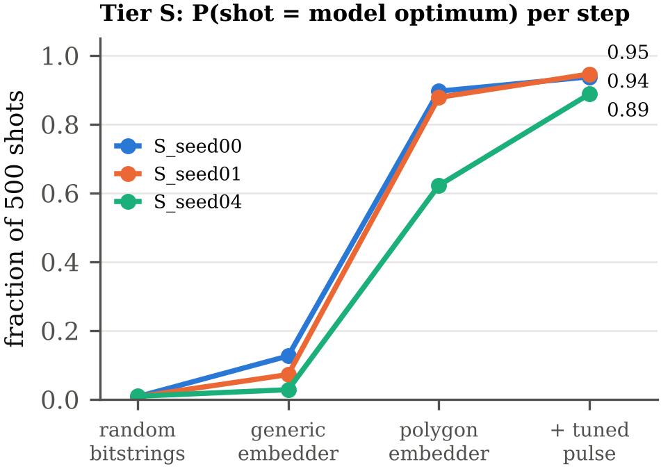
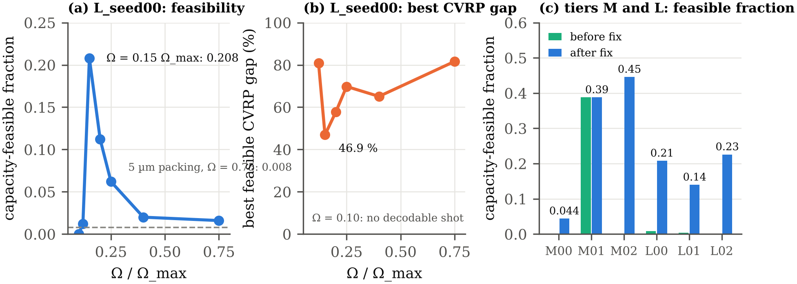
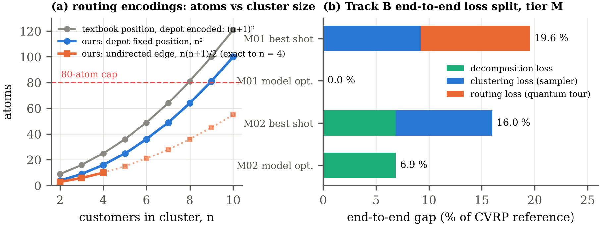

# Spending Fewer Atoms

### Slack-free one-hot clustering of the Capacitated Vehicle Routing Problem on an analog neutral-atom register

**🏆 Winner of the Standard Track at the DuQuantum 2026 Hackathon** (Pasqal challenge: *Analog quantum devices for optimization problems*)

**Team Qualies:** Darren Lau · Richard Chen

[📄 Report (4 pages)](submission/report.pdf) · [📘 Full technical write-up](docs/WRITEUP.md) · [💡 Plain-language explainer](submission/EXPLAINER.md) · [🎤 Talk script](submission/PRESENTATION_SCRIPT.md)

---

## Overview

We put the clustering half of the capacitated vehicle routing problem (CVRP) onto Pasqal's `AnalogDevice` **with no
slack atoms at all**. Customers are assigned to vehicles with one-hot variables. The capacity inequality is handled by
*unbalanced penalization*, which on one-hot strings collapses exactly to a load-balance coupling. Every coupling is
then positive and every linear term is equal, so the model runs on a **single global detuning** (no DMM) with only
**N·K atoms**: 8 / 30 / 60 on tiers S / M / L, against 14 / 45 / 80 for the textbook slack encoding.

From there, we measured every change that took the model from paper to a working register:

- **Tier S (8 atoms):** a structure-aware embedder (rigid 5 µm polygons fitted on the one-hot subspace) raised the
  share of raw shots that are the model-optimal clustering from **3–13 % to 62–90 %**. A pulse scan then raised it to
  **89–99 % on all five instances**, with feasibility 0.95–1.00.
- **Tier M (30 atoms):** a derived physical bound on the final detuning took decodable shots from **0 % to 98–100 %**.
- **Tier L (60 atoms, K = 4):** matching the register geometry and drive to the K = 4 energy scale took
  capacity-feasible shots from **under 1 % to 14–23 %**.

All numbers are **raw shots**: no repair, no DMM. Every gap is computed on feasible decodes only, and everything that
did not work is listed.



*S_seed00 end to end. (a) The proven-optimal clustering, routed exactly (C\* = 263.0). (b) The 8-atom register: four
5 µm dimers, one per customer. Bold atoms are excited in the most frequent shot. (c) 500 QuTiP shots: the two labelings
of the optimal clustering make up 93.8 % of shots, and 99.8 % are capacity-feasible.*

---

## How it works

**1. Decompose.** Encoding vehicle *and* visit order needs ~N²K binaries, so we go cluster-first, route-second. The
register decides which customers share a vehicle, and each cluster is routed exactly by Held–Karp. The cost of this is
the decomposition gap, which we report on every instance.

**2. Match the hardware.** At the end of the pulse (Ω = 0) the device assigns each bitstring the energy

$$E_\text{dev}(x) = -\delta_f \sum_i x_i + \sum_{i<j} \frac{C_6}{r_{ij}^6}\, x_i x_j .$$

That is a QUBO with three built-in rules: **one shared linear coefficient**, **all couplings positive**, and couplings
**never exactly zero**. Any model we run has to respect all three.

**3. The model: one-hot, no slack.** Let x<sub>ik</sub> = 1 if customer *i* rides on vehicle *k*. The exactly-one
penalty gives a uniform linear term and positive intra-customer couplings. Unbalanced penalization of capacity
[[1]](#references) adds no auxiliary bits. Its linear part is constant on every one-hot string (the *one-hot
identity*), so it can be dropped exactly, leaving a soft load-balance coupling:

$$E(x) = \sum_k \sum_{i<j} w_{ij}\, x_{ik} x_{jk} + A \sum_i \Big(1 - \sum_k x_{ik}\Big)^2, \qquad w_{ij} = d_{ij} + 2\lambda_2 d_i d_j .$$

**4. Embed: ask the register for less.** A generic embedding of the coupling graph has a relative coupling error of
0.95. On valid strings, cross-vehicle couplings don't need to vanish, they only need to be *constant*. Our embedder
(`cvrp/embed_onehot.py`) makes each customer a rigid regular K-gon of side 5 µm (which realises the exactly-one clique
exactly), then fits only polygon centres, orientations and δ<sub>f</sub> so that one-hot energies match the QUBO.

**5. Respect two derived bounds.** One excitation per polygon beats two only if 0 < δ<sub>f</sub> < U<sub>min</sub>. For
a K = 4 square, the diagonal is √2 longer, and 1/r⁶ makes that coupling **8× weaker** (U<sub>min</sub> = 6.9 rad/µs).
Both bounds are enforced in code.

**6. Pulse.** Three-point Ω ramp plus a linear δ sweep, built and validated with Pulser on `AnalogDevice`. A
duration × amplitude scan picked **T = 5800 ns at 0.75 Ω<sub>max</sub>** for tier S.

| Encoding | S | M | L | fits 80 atoms? |
|---|---|---|---|---|
| Textbook (one-hot + binary slack) | 14 | 45 | 80 | at the cap on L |
| **Ours (one-hot + unbalanced penalization)** | **8** | **30** | **60** | yes |

---

## Results

### The improvement ladder

Each change was measured on the same instances and committed registers, before and after (500 raw shots per row).
P(opt) is the fraction of shots that are the model-optimal clustering.

| # | Change | Measured on | Before → after |
|---|---|---|---|
| 1 | Textbook slack → **one-hot + unbalanced penalization** | all tiers | Atoms 14/45/80 → **8/30/60**; linear terms → uniform |
| 2 | Generic embedder → **polygons fitted on the one-hot subspace** | S_seed00/01/04 | P(opt) 0.13/0.07/0.03 → **0.90/0.88/0.62** |
| 3 | Pulse 4000 ns at Ω<sub>max</sub> → **5800 ns at 0.75 Ω<sub>max</sub>** | S_seed00/01/04 | P(opt) → **0.94/0.95/0.89** |
| 4 | **Enforce δ<sub>f</sub> < U<sub>clique</sub>** | M_seed00/02 | Decodable 0/0 → **0.99/1.00** |
| 5 | **Bound from the weakest polygon pair** | tier L | δ<sub>f</sub> 35.8 → 4.5 rad/µs |
| 6 | Polygon spacing **5 µm → 8 µm** | L_seed00/01/02 | Optimum's one-hot rank 16 534 → 1 795 (L_seed00) |
| 7 | **Drive matched to the K = 4 scale** (Ω 0.75 → 0.15 Ω<sub>max</sub>) | L_seed00/01/02 | Feasible 0.008/0.004/0 → **0.208/0.140/0.226** |
| 8 | Bond dimension χ 32 → 64 | M_seed01 | Best CVRP gap 9.2 → **5.9 %** |

### Best final row per tier

| Instance | Atoms | Feasible | Model gap | CVRP gap | P(reach C\*) | Reference | Emulation |
|---|---|---|---|---|---|---|---|
| S_seed00 | 8 | 1.00 | 0.0 % | 0.0 % | 0.94 | proven | QuTiP, exact |
| S_seed02 | 8 | 1.00 | 0.0 % | 0.0 % | 0.99 | proven | QuTiP, exact |
| M_seed01 | 30 | 0.39 | 33.8 % | 5.9 % | 0.00 | best known | emu-mps χ = 64 |
| L_seed02 | 60 | 0.23 | 47.1 % | 36.3 % | 0.00 | best known | emu-mps χ = 32 |

For context, random bitstrings reach the optimum in about 1 % of shots, uniformly random valid assignments in 12.5 %,
and Pasqal's `qubo-solver` pipeline in 0–79 %. All 79 result rows are in [`results.csv`](results.csv).





### Track B: routing (supplementary)

Two routing encodings with fewer variables than the textbook (n + 1)²: a **depot-fixed position** encoding (n² bits,
tour length exact on every valid string) and an **undirected-edge** encoding (n(n+1)/2 bits, exact for n ≤ 4). Both
were verified by exhaustive enumeration on 18 cases. End-to-end gaps on tier M are 19.6 % and 16.0 %, split exactly
into decomposition, clustering and routing loss. See [`docs/ROUTING.md`](docs/ROUTING.md).



### What did not work

Generic embeddings (error 0.95). One-hot cliques at K ≥ 3, which still distort the ordering of clusterings. Unbounded
δ<sub>f</sub> on tier M (0 decodable shots). The tight penalty A, which is provably sound but drops P(opt) from 0.94 to
0.03. `qubo-solver`'s annealer getting stuck on the same non-optimal string. Generic embedding for routing (1 valid tour
in 10 000 shots). The full list, plumbing included, is in [`docs/DID_NOT_WORK.md`](docs/DID_NOT_WORK.md).

---

## Quick start

```bash
python -m pip install -r requirements.txt   # pinned environment, Python 3.11+
python scripts/make.py demo                 # validate instances, assert device limits, run S_seed00 on QuTiP, 500 shots
```

The demo runs the headline row on the committed register in `embeddings/`. The register, the pulse and every
classical number reproduce exactly. Emulator sampling reproduces to within sampling noise.

```bash
python -m cvrp.run --instance instances/S_seed00.json --formulation onehot-ub \
    --embedder polygons --backend qutip --shots 500 --seed 0
#   --backend   qutip | emu-sv | emu-mps (--bond-dim 32) | numpy-sv | random | random-onehot
#   --embedder  generic | polygons | polygons-cross8
python -m cvrp.validator instances/          # re-check every instance and its certificate
python scripts/make.py test                  # test suite
```

Every command is listed in [`docs/WRITEUP.md` §12](docs/WRITEUP.md#12-repository-map-and-how-to-reproduce-everything).

## Repository layout

| Path | Contents |
|---|---|
| `cvrp/` | Track A: instances, validator, exact solver, formulations, embedders, pulse, runner, metrics, results |
| `routing/` | Track B: routing encodings, exhaustive checks, pilot, cluster solver |
| `qopt/` | Generic QUBO → register → schedule toolkit the challenge code builds on |
| `instances/`, `embeddings/` | 11 seeded instances with certificates; committed registers |
| `results.csv` | One row per (instance, method, seed) |
| `submission/` | Report PDF and LaTeX source, figures, explainer, talk script |
| `docs/` | Full write-up, derivations, model proofs, routing, failure log, API notes |
| `scripts/`, `tests/` | Scans, reference solvers, report build; test suite |

## References

1. J. A. Montañez-Barrera, D. Willsch, A. Maldonado-Romo, K. Michielsen, *Unbalanced penalization: a new approach to
   encode inequality constraints of combinatorial problems for quantum optimization algorithms*, Quantum Sci. Technol.
   9, 025022 (2024), [arXiv:2211.13914](https://arxiv.org/abs/2211.13914).

Built with [Pulser](https://github.com/pasqal-io/Pulser), emu-sv / emu-mps and `qubo-solver` from Pasqal, for the
DuQuantum 2026 Hackathon.
